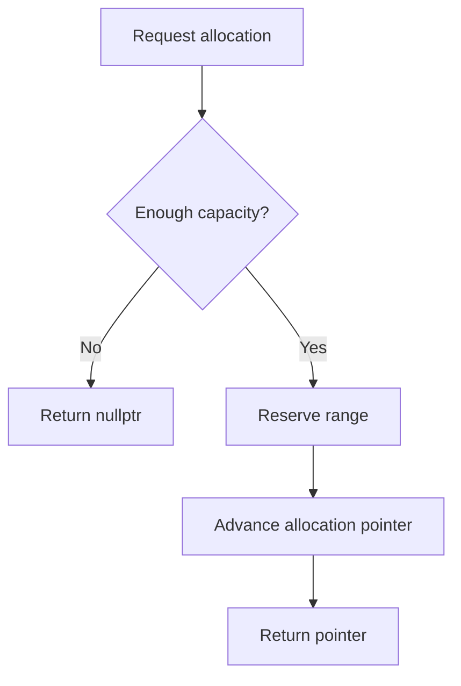
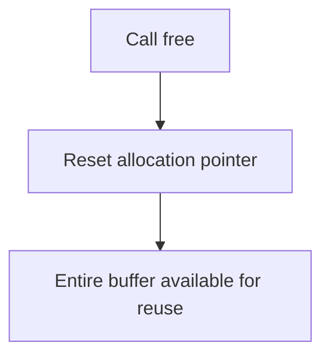
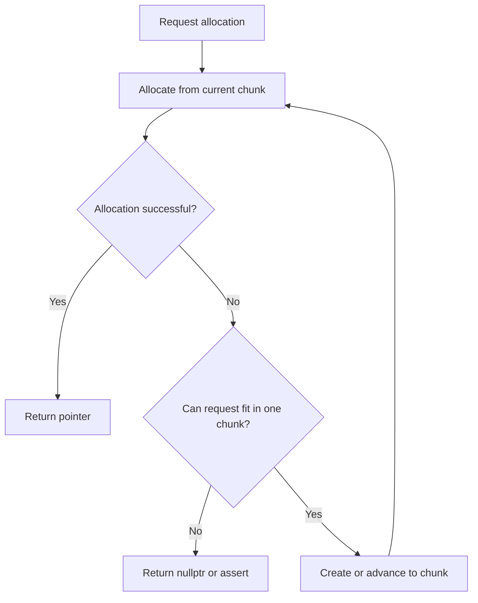
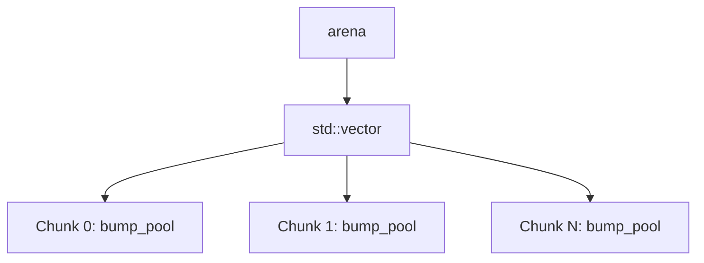

# memory-poollib

Several lightweight, specialised memory pool implementations in C++ designed for
efficient allocation and reuse of memory.

## Features

- **Two allocator types:** bump allocator and arena allocator
- **Templated and header-only** for straightforward integration into existing projects
- **Compile-time capacities** to provide fixed-size allocation chunks
- **Thread-safe variants** using atomic allocation state
- **Bulk reclamation** by resetting allocation state without reconstruction
- **Aligned byte allocation** through the `char` specialisation
- **CMake integration** for dependency management

## Motivation

Primarily came from [my work on another project](https://github.com/ms1d/bvh-builder)
where I wanted a **lightweight** alternative to other existing memory management
solutions. By constraining the requirements of this project, I was able to create
something decently performant and viable in certain performance-critical scenarios.

## Types

### Bump allocator — `include/bump_pool.hpp`

`bump_pool<obj, pool_capacity, pool_type>` allocates contiguous ranges from a
fixed-capacity buffer by advancing an allocation pointer.

- `thread_unsafe`: uses a regular pointer for allocation state.
- `thread_safe`: uses atomic compare-and-exchange operations to reserve disjoint
ranges concurrently.

Allocations are performed using `alloc(count)`, which returns a pointer to the
allocated range or `nullptr` when insufficient capacity remains.

For `obj = char`, an additional `align` argument is available:

```cpp
char* alloc(uint32_t count = 1, uint32_t align = 1);
```

Here, `count` represents the number of bytes (`char`s) requested. Alignment is
carried out using the absolute address of the current head pointer rather than
its offset from `data`.

Calling `free()` resets the allocation pointer to the start of the buffer. It does
not release the buffer's storage to the kernel.

### Arena allocator — `include/arena_pool.hpp`

`arena<obj, chunk_capacity, pool_type>` builds on `bump_pool` to support allocations
across multiple fixed-capacity chunks.

When the current chunk cannot satisfy an allocation, the arena creates or advances
to another chunk and retries the allocation.

- `thread_unsafe`: stores chunks in a `std::vector`.
- `thread_safe`: maintains a linked list of chunks and uses atomic operations to
coordinate allocation and chunk growth.

The arena extends bump allocation across multiple fixed-size chunks, similar to
`std::hive` (but not nearly as generalised).

The `char` specialisation also supports aligned byte allocations.

## Architecture Diagrams

### Bump allocator

#### Bump Allocation workflow



The thread-unsafe implementation advances a regular pointer. The thread-safe
implementation reserves ranges using atomic compare-and-exchange, allowing concurrent callers to obtain non-overlapping allocations.

#### Bump Reset workflow



Resetting the pool does not release its backing allocation. Previously returned
pointers must no longer be used for data that needs to be preserved.

### Arena allocator

#### Arena Allocation workflow



An individual allocation must fit within a single chunk. The arena grows by adding
chunks rather than by enlarging an existing buffer.

The failure behaviour depends on the variant: the thread-unsafe arena returns `nullptr`
when `count` exceeds `chunk_capacity`, whereas the thread-safe arena asserts this
precondition.

#### Arena Chunk organisation

##### Thread-unsafe arena



##### Thread-safe arena


The thread-safe variant uses atomic pointers to coordinate access to the linked
list and the chunk used for allocation. Chunk growth and allocation are separate
operations; the list should not be assumed to be fully linked at every intermediate
point.

## Design Decisions

### Fixed-capacity chunks

Both allocator types use compile-time capacities. This avoids resizing an existing
allocation buffer and makes allocation failure predictable when a request exceeds
the available capacity.

The trade-off is that an individual request cannot span multiple chunks. The arena
accommodates larger total workloads by adding chunks, not by combining chunks for
a single allocation.

### Bump allocation

A bump allocator does not search for free blocks or maintain per-allocation metadata.
It reserves a contiguous range and advances its allocation state.

This makes allocation straightforward and allows bulk reclamation. It is particularly
useful when allocations share a common lifetime, such as temporary data generated
during a frame, task, or processing stage.

### Atomic allocation

The thread-safe bump allocator uses compare-and-exchange to reserve ranges of the
buffer. The successful atomic update determines which range belongs to each allocation.

The thread-safe arena builds on this allocator and adds concurrent chunk growth.
Atomic allocation does not make every operation on the allocator safe to call
concurrently: `free()` still requires external synchronisation.

### Bulk reclamation

Both allocators expose `free()` to reuse previously allocated memory without releasing
and recreating the backing storage.

The arena's `free(n)` interface also allows the thread-unsafe variant to discard
a specified number of trailing chunks. The thread-safe arena instead resets its
chunk allocation state and retains its linked-list storage.

## Build Instructions

The library is header-only and requires no separate compilation of implementation
files.

### Direct inclusion

Add `include/` to your project's include directories and include the required header:

```cpp
#include "bump_pool.hpp"
#include "arena_pool.hpp"
```

For example, with CMake:

```cmake
target_include_directories(your_target PRIVATE
    "${CMAKE_CURRENT_SOURCE_DIR}/path/to/memory-poollib/include"
)
```

Replace `your_target` and the path with the appropriate values for your project.

### CMake FetchContent

The repository can also be obtained through CMake's `FetchContent`:

```cmake
include(FetchContent)

FetchContent_Declare(
    memory-poollib
    GIT_REPOSITORY https://github.com/ms1d/memory-poollib.git
    GIT_TAG main
)

FetchContent_MakeAvailable(memory-poollib)

target_include_directories(your_target PRIVATE
    "${memory-poollib_SOURCE_DIR}/include"
)
```

This example adds the headers to the target's include path directly. It does not
depend on a particular CMake target name being exported by the library. For reproducible
builds, use a release tag or commit hash rather than following main.

## Usage

### Bump allocator

```cpp
#include "bump_pool.hpp"

#include <cstdint>

int main() {
    bump_pool<int, 1024> pool;

    int* values = pool.alloc(16);
    if (values == nullptr) {
        return 1;
    }

    // Use values[0] through values[15].

    pool.free();

    // The previously allocated range can now be reused.
}
```

The pool has a capacity of 1024 `int` elements. The allocation requests 16 contiguous
elements.

The backing array is allocated when the pool is constructed. Allocations return
pointers into that array rather than creating separate allocations for each request.

### Thread-safe bump allocator

Select the thread-safe implementation through the `mp_type` template parameter:

```cpp
#include "bump_pool.hpp"

bump_pool<int, 1024, mp_type::thread_safe> pool;
```

Concurrent calls to `alloc()` can reserve disjoint ranges of the shared buffer.
The caller remains responsible for coordinating access to the allocated objects
themselves.

### Aligned byte allocation

Use `char` as the element type to allocate a specified number of bytes with an
alignment parameter:

```cpp
#include "bump_pool.hpp"

bump_pool<char, 4096> pool;

char* data = pool.alloc(128, 16);
if (data == nullptr) {
    return 1;
}
```

This allocates 128 bytes aligned to 16 bytes.

### Arena allocator

```cpp
#include "arena_pool.hpp"

int main() {
    arena<int, 1024> pool;

    int* first = pool.alloc(512);
    int* second = pool.alloc(512);
    int* third = pool.alloc(128);

    if (first == nullptr ||
        second == nullptr ||
        third == nullptr) {
        return 1;
    }

    // Use the allocated ranges.

    pool.free();
}
```

Each allocation is served by one chunk. When the current chunk cannot satisfy a
request, the arena advances to another chunk or creates one.

The example uses the default thread-unsafe variant. Its `free()` function resets
the current chunk and releases the requested number of trailing chunks, defaulting
to one. When the arena is already on its first chunk, that chunk is reset instead.

### Thread-safe arena

```cpp
#include "arena_pool.hpp"

arena<int, 1024, mp_type::thread_safe> pool;
```

This variant supports concurrent allocations and concurrent chunk growth. The
requested allocation count must not exceed `chunk_capacity`.

Do not call `free()` concurrently with allocations. Ensure all users of the arena
have finished before resetting it or destroying it.

## Benchmarks

> Planned. See issue #2

## Limitations

- **Fixed chunk capacity:** each individual allocation must fit within one chunk
- **No individual deallocation:** allocations cannot be freed independently
- **Object lifetime:** `free()` does not individually destroy allocated objects
- **Thread safety is alloc-only:** `free()` is never thread-safe
- **External synchronisation is required for reset and destruction:** ensure no
thread is using the allocator before either operation begins.
